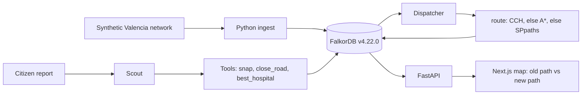
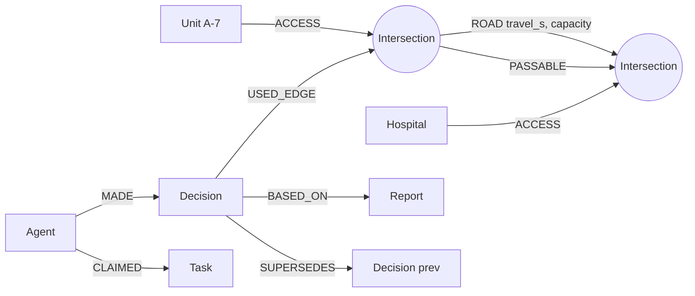

# Floodline

You're in a flooding Valencia street. Floodline routes you on real streets to the nearest open shelter, computed in FalkorDB, and bends the line when a report closes a road ahead. Scout, Dispatcher, and Analyst show their work live.

This is a solo entry for [WeMakeDevs × FalkorDB Graph Hacks](https://github.com/zaprillcom-cpu/Floodline). The city graph is an OpenStreetMap drive network for the Valencia flood corridor. A 10-node synthetic network remains as the offline fallback.

Live: API [floodline-production.up.railway.app](https://floodline-production.up.railway.app) · web [floodline-xi.vercel.app](https://floodline-xi.vercel.app). The web app is a full-screen MapLibre map (OpenFreeMap dark, 3D buildings). Desktop gets a side HUD. A phone gets bottom tabs (Escape, Report, Live, Me) and a bottom sheet. Navigation is simulated GPS along the FalkorDB line.

## Who owns what

Sahil writes and explains the graph model, the Cypher, and the LLM planner. Cursor Grok 4.7 built the slices marked AI-assist. Stubs marked `TODO(Sahil)` fall back to the existing router and the keyword planner so the map still runs. Full note: [AI_DISCLOSURE.md](AI_DISCLOSURE.md).

| Task | Owner | Where |
|---|---|---|
| Valencia extract inside `backend/`, `POST /api/admin/load-valencia` | AI-assist | `backend/floodline/api.py`, `backend/data/osm/` |
| Streets around the citizen, `POST /api/area/load` | AI-assist | `backend/floodline/area.py`, `web/components/EscapeApp.tsx` |
| Shelter and Citizen model (`NEAR`, `AT`, `CLOSES`) | Sahil | `ensure_shelter_citizen_model` in `backend/floodline/stubs.py` |
| `route_to_shelter` (snap → top-k open shelters → CCH) | Sahil | `route_to_shelter` in `backend/floodline/stubs.py` |
| MapLibre map, OpenFreeMap dark, 3D buildings | AI-assist | `web/components/FloodMap.tsx` |
| Design tokens | AI-assist | `web/lib/theme.ts` |
| LLM planner (`geocode`, `close_road`, `severity`) | Sahil | `plan_with_llm` in `backend/floodline/agents/llm_planner.py` |
| Report geocoding onto ROAD edges | Sahil | `geocode_report` in `backend/floodline/stubs.py` |
| Reroute fan-out and Decision explanations | Sahil | `reroute_affected` in `backend/floodline/stubs.py` |
| Snap and shelter-reachability WCC | Sahil | `snap_point`, `shelter_reachability` in `backend/floodline/stubs.py` |
| SSE `GET /api/stream` | AI-assist | `backend/floodline/events.py` |
| Turn-by-turn steps and simulated GPS | AI-assist | `backend/floodline/navigation.py`, `web/lib/geo.ts` |
| Live agent feed | AI-assist | `web/components/AgentFeed.tsx` |
| Mobile tabs and bottom sheet | AI-assist | `web/components/MobileShell.tsx` |
| Desktop HUD | AI-assist | `web/components/DesktopHud.tsx` |
| Flood vision (UI). WCC query is Sahil's | AI-assist / Sahil | `FloodMap.tsx` / `shelter_reachability` |
| Me tab (localStorage) | AI-assist | `web/components/MePanel.tsx` |
| This README, disclosure, queries draft | AI-assist draft, Sahil reviews | this file, `AI_DISCLOSURE.md`, `docs/queries.md` |
| Demo video | Sahil | — |

## Environment

| Where | Variable | Value |
|---|---|---|
| Railway (service root `backend`) | `ADMIN_TOKEN` | secret. Guards `POST /api/admin/load-valencia`. Do not commit it. |
| Vercel | `FLOODLINE_API_ORIGIN` | `https://floodline-production.up.railway.app` (no trailing slash) |
| Local API | `FALKORDB_HOST`, `FALKORDB_PORT`, `FALKORDB_GRAPH` | see `.env.example` |

Load the corridor once the token is set:

```bash
curl -X POST https://floodline-production.up.railway.app/api/admin/load-valencia \
  -H "Authorization: Bearer $ADMIN_TOKEN"
```

`/api/state` should then report `loaded: true` with 2526 intersections and 4742 ROAD edges. Routing stays in FalkorDB: CCH, then A*, then `algo.SPpaths`.

## Around you

The map asks for the browser's location on first load. If permission is already granted, it loads that tile. Otherwise it waits for **Use my location** or a bundled city (Valencia, Mumbai, New York). The same picker is in the desktop HUD and the mobile Escape tab. If a live download fails, the picker is shown immediately.

`POST /api/area/load` takes `{ "lat", "lon", "radius_m" }` and returns immediately with `{ "job_id", "status": "queued" }`. `radius_m` defaults to 2000 and is rejected above 5000. It does **not** use `ADMIN_TOKEN`. Poll `GET /api/area/status?job_id=…` for `queued`, `fetching`, `indexing`, `ready`, or `failed`.

A point inside a bundled region never calls Overpass. The worker crops a 2–3 km tile from a SQLite street table in `backend/data/regions/`, loads that tile into its own FalkorDB graph, builds the CCH index, and attaches shelters and hospitals from the same file. Shelters are `amenity=school|community_centre|social_facility` and `leisure=sports_centre`, capped at 8, and still go through `ensure_shelter_citizen_model`. Hospitals (`amenity=hospital`) are capped at the 4 nearest. Offline loads are not rate-limited. Overpass is only the fallback outside those regions: one drive query, `User-Agent: Floodline/1.0 (https://github.com/zaprillcom-cpu/Floodline)`, mirrors `overpass-api.de`, `overpass.kumi.systems`, `overpass.private.coffee`, then `maps.mail.ru`, sharing a 40 second budget (10 seconds each). It does not use OSMnx's status-endpoint pause.

| Region | File | Coverage | Default centre |
|---|---|---|---|
| Greater Mumbai | `backend/data/regions/mumbai.sqlite` (~38 MB) | 18.89–19.30 N, 72.77–73.00 E | Goregaon, 19.1663, 72.8526 |
| Manhattan | `backend/data/regions/manhattan.sqlite` (~8 MB) | 40.698–40.882 N, 74.03–73.91 W | Midtown, 40.758, −73.9855 |
| Wider Valencia | `backend/data/regions/valencia.sqlite` (~12 MB) | 39.38–39.55 N, 0.50–0.28 W | Paiporta, 39.4294, −0.4183 |

The three files are committed in git (not Git LFS). Together they are about 59 MB, under GitHub's 100 MB file limit and inside a Railway image. A Goregaon crop (19.1663, 72.8526, 2500 m) is about 6,300 nodes and 14,000 edges, finishes in a few dozen milliseconds, and stays near 21 MB of process RSS. The nearest intersection is on Aarey Road, about 9 m from that point, so the route starts there. FalkorDB is a separate service; a tile of this size is the same order as the Valencia corridor that already loads. Railway Hobby allows up to 48 GB RAM and a large image; even a tighter free/trial image cap (about 4 GB) and ephemeral disk (about 1 GB) fit this data.

The graph name is a 0.05° tile, for example `fl-p1915-p07285` for Goregaon and `fl-p3945-n00040` for 39.45, −0.40. A second load of that tile is read from FalkorDB. Uncached Overpass loads are limited to 4 per minute per client (`X-Forwarded-For`, otherwise the peer address).

`GET /api/route` returns the line, ETA, `distance_m`, turn-by-turn steps that start at the requested coordinate, and up to five nearer shelters and hospitals. `?dest=` routes to one of those places through the existing CCH chain. The default call, with no `dest`, is still `route_to_shelter`. Overlay, zones, feed, and SSE take `?graph=`. Reports may send the same id in the JSON body. Unknown ids are 400.

`POST /api/road/reopen` marks a closed road clear. It restores `travel_s` from `base_travel_s`, recreates the `PASSABLE` mirrors, writes a `reopen` Decision (the SSE feed picks that up), and reroutes. Body: `{ "road_id": "..." }`, or `{ "lat", "lon" }` for closures within 800 m, or `{ "clear_test": true }` to reopen every closure on that graph. No admin token. The closed-road overlay includes the report text, type, time, agent, and Decision id.

`POST /api/area/city/mumbai` and `/nyc` crop the offline tile at the region centre (Goregaon, midtown). `POST /api/area/city/valencia` and `POST /api/area/valencia` still load the curated Paiporta corridor (`valencia_corridor.json`, graph `valencia`). The city buttons in the map call `/api/area/load` instead: if the last GPS fix is inside that city's box, the tile is centred on the fix and navigation follows `watchPosition`; otherwise the tile uses the centre above and the puck simulates movement along the route. The destination card names the shelter or hospital, the distance, and the ETA. The active pin is marked Destination, and the camera fits the route.

If Overpass fails outside a bundled region, the job status is `failed` and the map shows the city picker straight away. The map also stops if the status message does not change for 45 seconds.

```bash
curl -X POST http://127.0.0.1:8000/api/area/load \
  -H 'content-type: application/json' \
  -d '{"lat":19.1663,"lon":72.8526,"radius_m":2500}'

curl "http://127.0.0.1:8000/api/area/status?job_id=JOB"

curl -X POST http://127.0.0.1:8000/api/area/valencia

curl -X POST http://127.0.0.1:8000/api/area/city/mumbai

curl -X POST http://127.0.0.1:8000/api/area/city/nyc

curl 'http://127.0.0.1:8000/api/route?lat=39.4294&lon=-0.4183&graph=valencia'

curl 'http://127.0.0.1:8000/api/route?lat=19.1663&lon=72.8526&graph=fl-p1915-p07285'
```

Limits: radius 50–5000 m (default 2000; the map asks for 2500 inside a bundled region), tile 0.05°, 4 uncached Overpass downloads per minute, 8 provisional shelters, 4 hospitals, four Overpass mirrors sharing a 40 s budget. Offline tiles skip that limit. An area with no shelter candidates has nowhere to route until Sahil's model, or a bundled city, supplies one. `ADMIN_TOKEN` still guards only `POST /api/admin/load-valencia`.

**Tracks:** Track 1 — Agents That Act on Connected Data (primary). Track 2 — Agent Memory & Coordination.

The live URLs are above. The demo video is still Sahil's. Local setup below is how to reproduce the graph.

## What this slice does

1. `docker compose up` starts **FalkorDB v4.22.0** (not `:latest`).
2. The synthetic loader writes 10 `Intersection` nodes, directed `ROAD` edges (`travel_s`, `capacity`), and `PASSABLE` mirrors. The OSM loader is the next section.
3. Scout closes the V-31 Paiporta bridge: `travel_s = 1000000000`, `capacity = 0`, and the `PASSABLE` edges for that road are deleted.
4. Dispatcher recomputes A-7’s route. Before: **215 s** across the bridge. After: **320 s** via Alfafar and Sedaví. The `Decision` node says why.
5. The Next.js app draws that route on a MapLibre map of Valencia. The older schematic view is no longer the home page.

Checked on v4.22.0: `db.idx.cch.query`, `algo.AStar`, and `algo.SPpaths` all return 215 s before the closure and 320 s after. The running router is **CCH**. If CCH or A* is missing or still walks a closed edge, routing falls through to `algo.SPpaths`.

## Valencia drive network

`scripts/load_valencia.sh` loads a real OSMnx drive graph into FalkorDB and proves that closing one road changes a CCH route.

| | |
|---|---|
| Tool | OSMnx 2.1.1, `network_type='drive'`, simplified |
| BBox (west, south, east, north) | `-0.430, 39.415, -0.372, 39.458` |
| Coverage | Paiporta, Alfafar, Sedaví, Benetússer, and Hospital Doctor Peset. About 5.0 km by 4.8 km. |
| Intersections | 2526 |
| Directed `ROAD` edges | 4742, each mirrored by `PASSABLE` while open |
| Districts | Nearest town centroid, not an official boundary. Paiporta 654, Alfafar 259, Sedaví 504, Benetússer 365, Valencia 744. Populations are synthetic. |
| Extract | `backend/data/osm/valencia_corridor.json` (ODbL, © OpenStreetMap contributors). Railway's service root is `backend/`, so the file ships with the API. `--refresh` re-downloads from Overpass. |

Checked on FalkorDB **4.22.0** (`MODULE LIST` reports version `42200`, and the container log says `Starting up FalkorDB version 4.22.0`):

```text
BEFORE  7 min 47 s (467 s)  algo=cch  hops=66
CLOSED  Carretera de Benetússer
AFTER   8 min 20 s (500 s)  algo=cch  hops=74
  delta: +33 s
DEMO OK
```

A-7 is snapped to an intersection in Paiporta (about 46 m from the seed point). The destination is the intersection nearest Hospital Doctor Peset (about 206 m). The closure is weight-only: `travel_s = 1000000000`, `capacity = 0`, and that edge’s `PASSABLE` mirror is deleted. The `ROAD` edge stays, so the CCH index only re-customizes the weight. The new path does not use the closed edge.

If the extract is missing and Overpass cannot be reached, the script runs the synthetic demo and says so.

```bash
docker compose up -d
python3 -m venv .venv && source .venv/bin/activate
pip install -r backend/requirements.txt
scripts/load_valencia.sh
```

`docker compose` sets `FALKORDB_ARGS` so the query timeout is 120 s and the result-set cap is 1,000,000. The image default timeout is 1 s, which is too small for this graph. The Python client sets the same values on connect.

## Why FalkorDB is essential

Remove FalkorDB and this slice stops working. The route is not computed in Python.

| Question | What answers it |
|---|---|
| Fastest open path for A-7 | `db.idx.cch.query` on `ROAD.travel_s` (fallback `algo.AStar`, then `algo.SPpaths`) |
| A closure that does not rebuild the road topology | Property update. CCH re-customizes weights. `PASSABLE` is outside that index. |
| Which hospital is reachable, and which has beds | The same shortest-path procedure, once per `Hospital` with `beds_free > 0` |
| Why did the route change? | `Decision -[:SUPERSEDES]-> Decision` and `Decision -[:BASED_ON]-> Report` |
| Who claimed the reassess task? | One write query: `Task.status` goes from `open` to `claimed` and `Agent -[:CLAIMED]-> Task` |

`:latest` (FalkorDB 6.x at the time of the design notes) does not ship A* or CCH yet. Those procedures are on the C engine in **v4.22.0**. The compose file pins `falkordb/falkordb:v4.22.0`. `algo.SPpaths` is the fallback if that image cannot answer a CCH or A* call.

`algo.WCC` on `PASSABLE` marks a district cut off when it cannot reach a hospital. `algo.maxFlow` on `ROAD.capacity` is the evacuation rate from that district to shelters. On the synthetic network, closing the three roads out of Paiporta flips it to cut off and drops max-flow from 1200 to 0 veh/h. The saturated critical edge before that closure is the V-31 Paiporta bridge (600 of 600). Run `PYTHONPATH=backend python -m floodline.evac_demo`.

## Architecture



Scout and Dispatcher do not message each other. Scout writes a `Report`, a close `Decision`, and a `reassess` `Task`, then a `HANDOFF`. Dispatcher claims that task and writes a route `Decision` that `SUPERSEDES` the previous one.

The planner (`backend/floodline/agents/planner.py`) is a deterministic stub. It only picks a tool. See [AI_DISCLOSURE.md](AI_DISCLOSURE.md).

## Graph data model

The synthetic demo and the OSM load use the same labels. Counts below are the synthetic demo unless noted. The OSM extract has 2526 intersections, and `ROAD` also stores `highway` and `base_capacity`.

| Label | Properties | Notes |
|---|---|---|
| `Intersection` | `osmid`, `name`, `lat`, `lon`, `loc` (point), `district`, `role` | 10 nodes in the synthetic demo, 2526 in the OSM extract. `role` is `junction`, `hospital`, `shelter`, or `depot`. |
| `Hospital` | `id`, `name`, `beds_total`, `beds_free`, `er_open` | Doctor Peset and La Fe. Bed counts are synthetic. Snapped onto OSM intersections in the corridor load. |
| `Shelter` | `id`, `name`, `capacity`, `occupancy` | Alfafar in the synthetic demo. The OSM load also adds a Benetússer shelter. Synthetic capacity. |
| `District` | `name`, `population`, `zone_id`, `population_source`, `cut_off` | Synthetic demo: Paiporta. OSM load: Paiporta, Alfafar, Sedaví, Benetússer, Valencia (nearest centroid). Population is synthetic. |
| `Unit` | `callsign`, `status`, `lat`, `lon` | Ambulance `A-7`, status `transport`. |
| `Report` | `id`, `text`, `received_at`, `channel`, `confidence` | The citizen report Scout ingests. |
| `Agent` | `name`, `role`, `heartbeat_at` | `Scout`, `Dispatcher`. |
| `Task` | `id`, `kind`, `status`, `priority`, `created_at`, `road_id`, `from_osmid`, `to_osmid` | `ingest_report` (done) and `reassess` (claimed, then done). |
| `Decision` | `id`, `seq`, `at`, `kind`, `algo`, `explanation`, `result_summary`, `superseded`, `travel_s`, `path_osmids`, `path_names`, `road_id` | `kind` is `route` or `close`. Paths are JSON strings. |
| `Meta` | `key`, `algo`, `available`, `seq` | Which router won the probe, and a sequence counter. |

| Relationship | From → to | Properties |
|---|---|---|
| `ROAD` | Intersection → Intersection | `road_id`, `name`, `osm_way` (`synthetic/…` or an OSM way id), `length_m`, `speed_kph`, `base_travel_s`, `travel_s`, `capacity`, `status`, and on closure `closed_at`, `closed_by`. OSM edges also have `highway` and `base_capacity`. |
| `PASSABLE` | Intersection → Intersection | `road_id`. Present only while the road is open. |
| `ACCESS` | Hospital, Shelter, or Unit → Intersection | `dist_m` |
| `IN_DISTRICT` | Intersection → District | |
| `CLAIMED` | Agent → Task | `at` |
| `HANDOFF` | Task → Task | `reason` |
| `MADE` | Agent → Decision | |
| `BASED_ON` | Decision → Report or Decision | |
| `AFFECTS` | Decision → Unit | |
| `USED_EDGE` | Decision → Intersection | `seq` |
| `SUPERSEDES` | Decision → Decision | The new route points at the old one. |

Indexes created at load: `Intersection(osmid)`, `Intersection(loc)`, `Hospital(id)`, `Task(status)`, `Decision(id)`, `ROAD(status)`, and `CREATE CCH INDEX FOR ()-[e:ROAD]->() ON (e.travel_s)`.



The replay command loads `Tick` and one synthetic `Incident`. `algo.WCC` and `algo.maxFlow` run in the cut-off demo and at tick 2. Still not loaded: `FloodZone`, and a vector index on `Report.emb`.

Full query text: [docs/queries.md](docs/queries.md).

## Reproduce one closure → one reroute

From the repo root:

```bash
cp .env.example .env
docker compose up -d
python3 -m venv .venv
source .venv/bin/activate
pip install -r backend/requirements.txt
PYTHONPATH=backend python -m floodline.demo
```

`scripts/demo_closure.sh` runs the same module. The container must already be up. `docker compose` pulls `falkordb/falkordb:v4.22.0`. Confirm the log line `Starting up FalkorDB version 4.22.0` and that the container image is that tag, not `:latest`.

What success looks like:

```text
Router: cch
BEFORE  A-7  3 min 35 s (215 s)
  Paiporta south → Paiporta north → Benetússer → Hospital Doctor Peset
closed V-31 Paiporta bridge (v31-paiporta-bridge)
  directed edges updated: 2
  PASSABLE remaining: 24
AFTER  5 min 20 s (320 s)
  Paiporta south → Alfafar → Sedaví → Benetússer → Hospital Doctor Peset
DEMO OK
```

The process exits 1 if the path does not change, does not get longer, or still crosses the bridge. It exits 2 if FalkorDB is not reachable.

Map UI, in a second terminal:

```bash
PYTHONPATH=backend uvicorn floodline.api:app --app-dir backend --port 8000
```

And in a third:

```bash
cd web
npm install
npm run dev
```

Open http://localhost:3000. The map is Valencia at night. **Start navigation** moves a simulated position along the FalkorDB line and the banner names the next turn. **Water on the road ahead** files a report with a coordinate on the route, which the keyword planner closes via `close_nearest`. The closed segment turns red and the line is requested again. Live lists Scout, Dispatcher, and Analyst from the SSE stream. On a phone-width window the desktop HUD is gone and the bottom tabs are Escape, Report, Live, and Me.

Tests:

```bash
cd backend && pip install -r requirements-dev.txt && pytest
```

`tests/test_scenario.py`, `tests/test_coordination.py`, and `tests/test_resume.py` skip unless something is already listening on `localhost:6379`. The coordination tests check that `claim_task` takes the highest-priority open task, that a missing agent does not claim, and that Scout’s `HANDOFF` is what Dispatcher turns into a `Decision` with `BASED_ON` evidence. The resume test claims a task, stops before the Decision, and checks that a later `resume` finishes that same task.

Crash and resume, as two processes:

```bash
PYTHONPATH=backend python -m floodline.resume_demo --crash
PYTHONPATH=backend python -m floodline.resume_demo --resume
```

`--crash` is Scout plus a claim, then exit. `--resume` does not reload the network. It reads the claimed task and the Dispatcher heartbeat from FalkorDB and writes the route Decision.

Replay the same morning on a fixed clock. Tick nodes are `seq` 0, 1, and 2. The incident id is `inc-seed-1`. Nothing in this command is random, and the times are reconstructed:

```bash
PYTHONPATH=backend python -m floodline.replay
```

```text
TICK 0  2024-10-29T14:01:00Z  route 215 s
TICK 1  2024-10-29T14:02:00Z  route 320 s  closed v31-paiporta-bridge
TICK 2  2024-10-29T14:15:00Z  cut_off=True  maxFlow 1200 → 0 veh/h
```

Closing the bridge changes A-7's ETA and does not change evacuation throughput. Closing the roads out of Paiporta is what drops max-flow to 0.

## Agents

| Agent | This slice |
|---|---|
| Scout | Stub planner extracts a road. `close_road` updates `ROAD` and deletes `PASSABLE`. Writes `Report`, close `Decision`, and a `reassess` task with `HANDOFF`. The origin is the `Unit` node in the graph. |
| Dispatcher | Claims the open `reassess` task in one query, and only if the `Agent` node exists. Calls `route`. Writes a route `Decision` with `SUPERSEDES`, `BASED_ON` (the close decision and the report), `USED_EDGE`, and `AFFECTS`. A new process resumes a task left `claimed` and then claims anything still `open`. |
| Analyst | `cut_off_areas` runs `algo.WCC` on `PASSABLE` and sets `District.cut_off`. |
| Evacuation planner | `evac_capacity` runs `algo.maxFlow` from the district to shelters and names the saturated critical edge. |

`explain(decision_id)` walks `BASED_ON` and `SUPERSEDES`. The returned narration is the stored explanation, not a model call.

## Data and licenses

The corridor graph is derived from OpenStreetMap (ODbL). The 10-node demo is synthetic. Beds, shelters, the ambulance, district populations, and the clock are synthetic in both. Details: [DATA_LICENSES.md](DATA_LICENSES.md).

The October 2024 DANA floods in Valencia killed more than 200 people. Floodline is a coordination exercise. It does not depict victims.

## AI assistance

Cursor Grok 4.7 wrote the loader, the API, the map, and the stubs. Sahil owns the Shelter/Citizen model, `route_to_shelter`, reroute fan-out, snap, shelter WCC, report geocoding, and the LLM planner. The in-product planner is still the keyword stub. Full note: [AI_DISCLOSURE.md](AI_DISCLOSURE.md).

## Team

Solo entry. Repository: [github.com/zaprillcom-cpu/Floodline](https://github.com/zaprillcom-cpu/Floodline). License: MIT.
