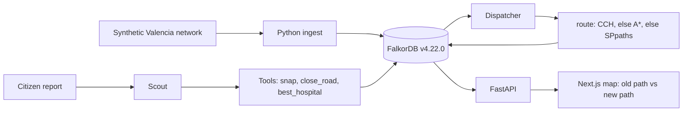
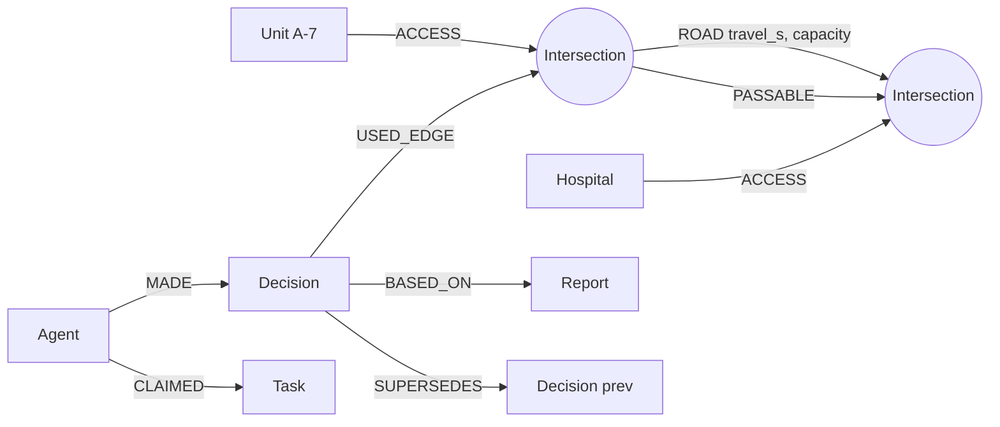

# Floodline

Disaster-response routing over a whole road network, not one car at a time. A citizen report closes a bridge in the graph. An ambulance’s route is recomputed there, and the reason is stored next to the edges that caused it.

This is a solo entry for [WeMakeDevs × FalkorDB Graph Hacks](https://github.com/zaprillcom-cpu/Floodline). The city graph is an OpenStreetMap drive network for the Valencia flood corridor. A 10-node synthetic network remains as the offline fallback and as the small map demo.

**Tracks:** Track 1 — Agents That Act on Connected Data (primary). Track 2 — Agent Memory & Coordination.

Live deployment and the demo video are not in this slice. Local setup below is the way to reproduce it.

## What this slice does

1. `docker compose up` starts **FalkorDB v4.22.0** (not `:latest`).
2. The synthetic loader writes 10 `Intersection` nodes, directed `ROAD` edges (`travel_s`, `capacity`), and `PASSABLE` mirrors. The OSM loader is the next section.
3. Scout closes the V-31 Paiporta bridge: `travel_s = 1000000000`, `capacity = 0`, and the `PASSABLE` edges for that road are deleted.
4. Dispatcher recomputes A-7’s route. Before: **215 s** across the bridge. After: **320 s** via Alfafar and Sedaví. The `Decision` node says why.
5. A Next.js map draws the old path (grey dash) and the new path (green).

Checked on v4.22.0: `db.idx.cch.query`, `algo.AStar`, and `algo.SPpaths` all return 215 s before the closure and 320 s after. The running router is **CCH**. If CCH or A* is missing or still walks a closed edge, routing falls through to `algo.SPpaths`.

## Valencia drive network

`scripts/load_valencia.sh` loads a real OSMnx drive graph into FalkorDB and proves that closing one road changes a CCH route.

| | |
|---|---|
| Tool | OSMnx 2.1.1, `network_type='drive'`, simplified |
| BBox (west, south, east, north) | `-0.430, 39.415, -0.372, 39.458` |
| Coverage | Paiporta, Alfafar, Sedaví, Benetússer, and Hospital Doctor Peset. About 5.0 km by 4.8 km. |
| Intersections | 2526 |
| Directed `ROAD` edges | 4742, each mirrored by `PASSABLE` while open |
| Districts | Nearest town centroid, not an official boundary. Paiporta 654, Alfafar 259, Sedaví 504, Benetússer 365, Valencia 744. Populations are synthetic. |
| Extract | `data/osm/valencia_corridor.json` (ODbL, © OpenStreetMap contributors). `--refresh` re-downloads from Overpass. |

Checked on FalkorDB **4.22.0** (`MODULE LIST` reports version `42200`, and the container log says `Starting up FalkorDB version 4.22.0`):

```text
BEFORE  7 min 47 s (467 s)  algo=cch  hops=66
CLOSED  Carretera de Benetússer
AFTER   8 min 20 s (500 s)  algo=cch  hops=74
  delta: +33 s
DEMO OK
```

A-7 is snapped to an intersection in Paiporta (about 46 m from the seed point). The destination is the intersection nearest Hospital Doctor Peset (about 206 m). The closure is weight-only: `travel_s = 1000000000`, `capacity = 0`, and that edge’s `PASSABLE` mirror is deleted. The `ROAD` edge stays, so the CCH index only re-customizes the weight. The new path does not use the closed edge.

If the extract is missing and Overpass cannot be reached, the script runs the synthetic demo and says so.

```bash
docker compose up -d
python3 -m venv .venv && source .venv/bin/activate
pip install -r backend/requirements.txt
scripts/load_valencia.sh
```

`docker compose` sets `FALKORDB_ARGS` so the query timeout is 120 s and the result-set cap is 1,000,000. The image default timeout is 1 s, which is too small for this graph. The Python client sets the same values on connect.

## Why FalkorDB is essential

Remove FalkorDB and this slice stops working. The route is not computed in Python.

| Question | What answers it |
|---|---|
| Fastest open path for A-7 | `db.idx.cch.query` on `ROAD.travel_s` (fallback `algo.AStar`, then `algo.SPpaths`) |
| A closure that does not rebuild the road topology | Property update. CCH re-customizes weights. `PASSABLE` is outside that index. |
| Which hospital is reachable, and which has beds | The same shortest-path procedure, once per `Hospital` with `beds_free > 0` |
| Why did the route change? | `Decision -[:SUPERSEDES]-> Decision` and `Decision -[:BASED_ON]-> Report` |
| Who claimed the reassess task? | One write query: `Task.status` goes from `open` to `claimed` and `Agent -[:CLAIMED]-> Task` |

`:latest` (FalkorDB 6.x at the time of the design notes) does not ship A* or CCH yet. Those procedures are on the C engine in **v4.22.0**. The compose file pins `falkordb/falkordb:v4.22.0`. `algo.SPpaths` is the fallback if that image cannot answer a CCH or A* call.

WCC and max-flow are on this image (`algo.WCC`, `algo.maxFlow`) and are not called yet. Cut-off detection and evacuation capacity are later slices. `PASSABLE` is already maintained so those queries can filter by relationship type.

## Architecture



Scout and Dispatcher do not message each other. Scout writes a `Report`, a close `Decision`, and a `reassess` `Task`, then a `HANDOFF`. Dispatcher claims that task and writes a route `Decision` that `SUPERSEDES` the previous one.

The planner (`backend/floodline/agents/planner.py`) is a deterministic stub. It only picks a tool. See [AI_DISCLOSURE.md](AI_DISCLOSURE.md).

## Graph data model

The synthetic demo and the OSM load use the same labels. Counts below are the synthetic demo unless noted. The OSM extract has 2526 intersections, and `ROAD` also stores `highway` and `base_capacity`.

| Label | Properties | Notes |
|---|---|---|
| `Intersection` | `osmid`, `name`, `lat`, `lon`, `loc` (point), `district`, `role` | 10 nodes in the synthetic demo, 2526 in the OSM extract. `role` is `junction`, `hospital`, `shelter`, or `depot`. |
| `Hospital` | `id`, `name`, `beds_total`, `beds_free`, `er_open` | Doctor Peset and La Fe. Bed counts are synthetic. Snapped onto OSM intersections in the corridor load. |
| `Shelter` | `id`, `name`, `capacity`, `occupancy` | Alfafar in the synthetic demo. The OSM load also adds a Benetússer shelter. Synthetic capacity. |
| `District` | `name`, `population`, `zone_id`, `population_source`, `cut_off` | Synthetic demo: Paiporta. OSM load: Paiporta, Alfafar, Sedaví, Benetússer, Valencia (nearest centroid). Population is synthetic. |
| `Unit` | `callsign`, `status`, `lat`, `lon` | Ambulance `A-7`, status `transport`. |
| `Report` | `id`, `text`, `received_at`, `channel`, `confidence` | The citizen report Scout ingests. |
| `Agent` | `name`, `role`, `heartbeat_at` | `Scout`, `Dispatcher`. |
| `Task` | `id`, `kind`, `status`, `priority`, `created_at`, `road_id`, `from_osmid`, `to_osmid` | `ingest_report` (done) and `reassess` (claimed, then done). |
| `Decision` | `id`, `seq`, `at`, `kind`, `algo`, `explanation`, `result_summary`, `superseded`, `travel_s`, `path_osmids`, `path_names`, `road_id` | `kind` is `route` or `close`. Paths are JSON strings. |
| `Meta` | `key`, `algo`, `available`, `seq` | Which router won the probe, and a sequence counter. |

| Relationship | From → to | Properties |
|---|---|---|
| `ROAD` | Intersection → Intersection | `road_id`, `name`, `osm_way` (`synthetic/…` or an OSM way id), `length_m`, `speed_kph`, `base_travel_s`, `travel_s`, `capacity`, `status`, and on closure `closed_at`, `closed_by`. OSM edges also have `highway` and `base_capacity`. |
| `PASSABLE` | Intersection → Intersection | `road_id`. Present only while the road is open. |
| `ACCESS` | Hospital, Shelter, or Unit → Intersection | `dist_m` |
| `IN_DISTRICT` | Intersection → District | |
| `CLAIMED` | Agent → Task | `at` |
| `HANDOFF` | Task → Task | `reason` |
| `MADE` | Agent → Decision | |
| `BASED_ON` | Decision → Report or Decision | |
| `AFFECTS` | Decision → Unit | |
| `USED_EDGE` | Decision → Intersection | `seq` |
| `SUPERSEDES` | Decision → Decision | The new route points at the old one. |

Indexes created at load: `Intersection(osmid)`, `Intersection(loc)`, `Hospital(id)`, `Task(status)`, `Decision(id)`, `ROAD(status)`, and `CREATE CCH INDEX FOR ()-[e:ROAD]->() ON (e.travel_s)`.



Reserved for later slices, not loaded yet: `Incident`, `FloodZone`, `Tick`, vector index on `Report.emb`, `algo.WCC` cut-off, `algo.maxFlow` evacuation capacity.

Full query text: [docs/queries.md](docs/queries.md).

## Reproduce one closure → one reroute

From the repo root:

```bash
cp .env.example .env
docker compose up -d
python3 -m venv .venv
source .venv/bin/activate
pip install -r backend/requirements.txt
PYTHONPATH=backend python -m floodline.demo
```

`scripts/demo_closure.sh` runs the same module. The container must already be up. `docker compose` pulls `falkordb/falkordb:v4.22.0`. Confirm the log line `Starting up FalkorDB version 4.22.0` and that the container image is that tag, not `:latest`.

What success looks like:

```text
Router: cch
BEFORE  A-7  3 min 35 s (215 s)
  Paiporta south → Paiporta north → Benetússer → Hospital Doctor Peset
closed V-31 Paiporta bridge (v31-paiporta-bridge)
  directed edges updated: 2
  PASSABLE remaining: 24
AFTER  5 min 20 s (320 s)
  Paiporta south → Alfafar → Sedaví → Benetússer → Hospital Doctor Peset
DEMO OK
```

The process exits 1 if the path does not change, does not get longer, or still crosses the bridge. It exits 2 if FalkorDB is not reachable.

Map UI, in a second terminal:

```bash
PYTHONPATH=backend uvicorn floodline.api:app --app-dir backend --port 8000
```

And in a third:

```bash
cd web
npm install
npm run dev
```

Open http://localhost:3000. **Reset network** reloads the graph and the 215 s route. **File flood report** sends the text in the box (the default names the V-31 bridge). The map then shows the grey route and the green detour, and the panel quotes the Decision.

Tests:

```bash
cd backend && pip install -r requirements-dev.txt && pytest
```

`tests/test_scenario.py` skips unless something is already listening on `localhost:6379`.

## Agents

| Agent | This slice |
|---|---|
| Scout | Stub planner extracts a road. `close_road` updates `ROAD` and deletes `PASSABLE`. Writes `Report`, close `Decision`, and a `reassess` task with `HANDOFF`. |
| Dispatcher | Claims the open `reassess` task in one query. Calls `route` and `best_hospital`. Writes a route `Decision` with `SUPERSEDES`, `BASED_ON`, `USED_EDGE`, and `AFFECTS`. |
| Evacuation planner, Analyst | Not started. The image has `algo.maxFlow` and `algo.WCC` for them. |

`explain(decision_id)` walks `BASED_ON` and `SUPERSEDES`. The returned narration is the stored explanation, not a model call.

## Data and licenses

The corridor graph is derived from OpenStreetMap (ODbL). The 10-node demo is synthetic. Beds, shelters, the ambulance, district populations, and the clock are synthetic in both. Details: [DATA_LICENSES.md](DATA_LICENSES.md).

The October 2024 DANA floods in Valencia killed more than 200 people. Floodline is a coordination exercise. It does not depict victims.

## AI assistance

Cursor Grok 4.7 wrote this slice in Cursor. The in-product planner is a stub. Full note: [AI_DISCLOSURE.md](AI_DISCLOSURE.md).

## Team

Solo entry. Repository: [github.com/zaprillcom-cpu/Floodline](https://github.com/zaprillcom-cpu/Floodline). License: MIT.
